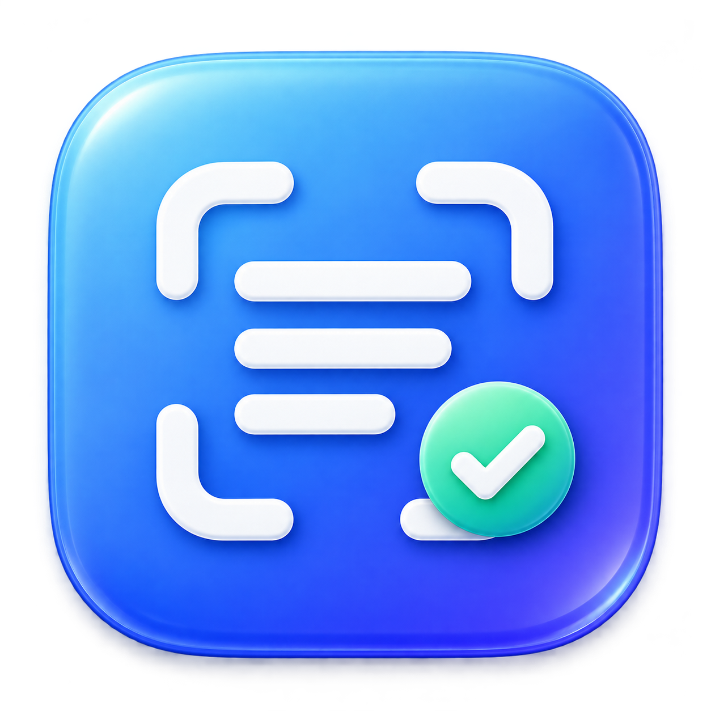

<p align="center"></p>

# MenuOCR

Select text on your screen. Copy it. Get back to what you were doing.

[Install](#install) · [Features](#features) · [Privacy](#privacy) · [Build](#build-it-yourself) · [Releases](https://github.com/Hassaankh10/MenuOCR/releases)

MenuOCR reads screenshots with local Tesseract OCR. It stays in your Mac’s menu bar or Windows system tray, ready when the words on screen aren’t selectable.

## Features

- **Capture text.** Press a shortcut and draw a box. Recognized text goes straight to your clipboard.
- **Choose how to copy.** The confirmation offers formatted or plain text. You can also re-copy the last result from the menu or a shortcut.
- **Readable formatting.** Keep paragraphs, indentation and approximate text sizes. Original fonts, bold, italic and colors aren’t reconstructed.
- **Multiple languages.** English is included. Add other Tesseract models; MenuOCR compares their recognition scores automatically.
- **Quiet by default.** Setup opens on first launch. Afterward, the app stays in the menu bar or tray. Confirmations appear at the bottom center without taking focus, and close after three seconds even while hovered.
- **Screenshot copying.** Copy the last captured image from the menu.

## Install

### macOS

With [Homebrew](https://brew.sh):

```sh
brew install --cask hassaankh10/menuocr/menuocr
```

Homebrew installs Tesseract automatically as a dependency.

Or download the DMG from [Releases](https://github.com/Hassaankh10/MenuOCR/releases/latest) and drag MenuOCR into Applications. The DMG and ZIP include Tesseract and English data; Homebrew isn’t needed.

Open MenuOCR and follow the Screen Recording setup. Accessibility permission is not required. These builds aren’t notarized; if macOS blocks the app, use **Open Anyway** in Privacy & Security.

Requires Apple Silicon and macOS 13 or newer.

### Windows

Download the Windows Setup EXE from [Releases](https://github.com/Hassaankh10/MenuOCR/releases), or extract the portable ZIP and open `MenuOCR.exe`.

The installer includes Tesseract, English data and .NET, and installs the Microsoft Visual C++ x64 runtime if needed. Builds are unsigned and currently previews. Requires Windows 10/11 x64. See [Windows instructions](Windows/README.md).

## Shortcuts

| Action | macOS | Windows |
| --- | --- | --- |
| Capture text | ⌘⇧O | Ctrl+Shift+O |
| Copy last result with formatting | ⌘⌃⇧C | Ctrl+Alt+Shift+C |
| Copy last result without formatting | ⌘⌃⇧V | Ctrl+Alt+Shift+V |

Change any shortcut in Settings. Escape cancels region selection. Capture automatically copies plain text; the popup buttons let you switch afterward. Formatted copying includes a plain-text fallback for apps that don’t accept rich text.

## Languages

Choose **Languages Folder** from the menu and add `.traineddata` files from [tessdata_fast](https://github.com/tesseract-ocr/tessdata_fast). On macOS, models installed through `brew install tesseract-lang` are also discovered.

Language selection is based on OCR confidence. Short or mixed-language text can be misidentified. More installed models mean longer recognition times.

## Privacy

Screenshots and recognition stay on your computer. No account or cloud OCR is needed. The app keeps the last screenshot and text result in memory until you quit; copied content remains on your system clipboard.

macOS needs Screen Recording permission to capture. Windows doesn’t need an equivalent permission switch for this capture method. Protected content and secure desktops may appear blank.

## Build it yourself

On macOS, install Xcode Command Line Tools and CMake:

```sh
xcode-select --install
brew install cmake

git clone https://github.com/Hassaankh10/MenuOCR.git
cd MenuOCR
./build.sh
```

The first build downloads verified OCR sources and English data, then builds a self-contained engine. The app is at `dist/MenuOCR.app`. Run `./make-dmg.sh` to create the disk image.

For Windows, see [build instructions](Windows/README.md#build).

## Uninstall

```sh
brew uninstall --cask hassaankh10/menuocr/menuocr
```

For a direct macOS install, quit MenuOCR and move it to Trash. On Windows, uninstall through Settings → Apps.

Report problems or suggest changes through [GitHub Issues](https://github.com/Hassaankh10/MenuOCR/issues).
